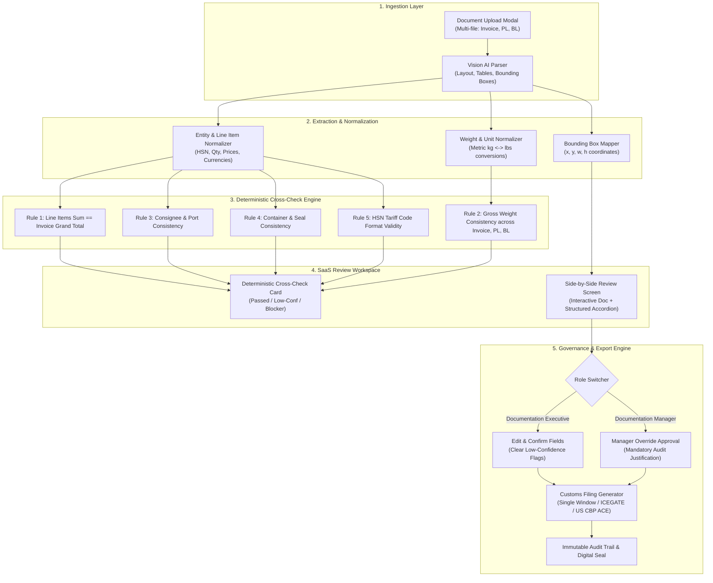
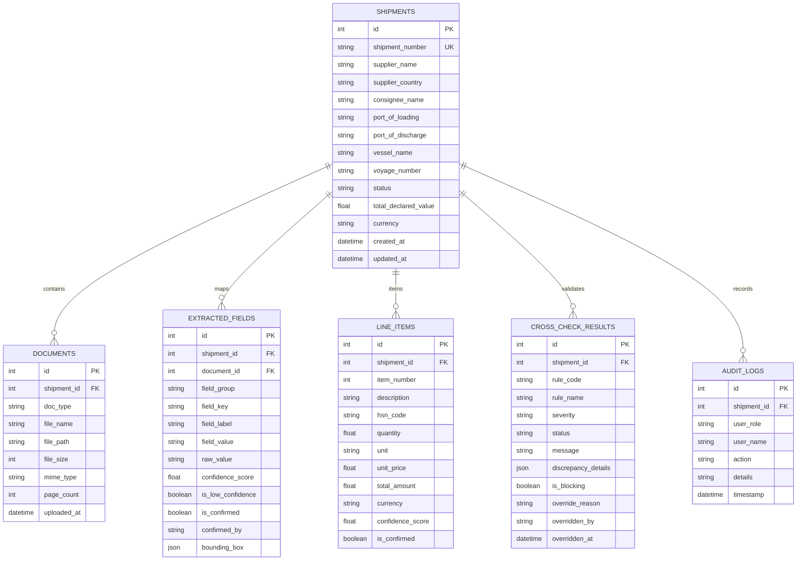

# Technical Design Document (TDD)
## Project 1: Customs Broker's AI Document Extraction & Cross-Check Tool
**Platform Name:** ClearBorder AI Enterprise  
**System Specification:** Single Window Customs Automation Engine (v4.2)  
**Author:** Principal Software Engineer & Full-Stack Architect  
**Status:** Approved for Production Deployment  

---

### 1. Executive Summary & Problem Space
Customs brokerage firms and freight forwarders process thousands of multi-jurisdictional shipping dockets daily. Each consignment requires cross-referencing at least three distinct documents:
1. **Commercial Invoice** (values, line items, currency, terms, declared weights)
2. **Packing List** (gross/net cargo weights, tare, pallets/cartons, container & seal numbers)
3. **Bill of Lading / Air Waybill** (carrier manifest, vessel/voyage, carrier gross weight, port of loading/discharge, consignee name)

Manual human reconciliation is slow (20–45 minutes per docket) and vulnerable to human fatigue. Even minor discrepancies (e.g., a 2.8% gross weight variance between the carrier scale and the packing list) can cause customs border holds, demurrage penalties ($300+/day/container), or severe trade compliance penalties.

**ClearBorder AI** provides an automated, deterministic verification platform that ingests multi-format documents via Vision AI, normalizes complex trade units, highlights low-confidence OCR fields with smart badges, and runs strict deterministic cross-checks that block invalid customs declarations from export.

---

### 2. High-Level System Architecture

---

### 3. Core Relational Data Model (SQLite / PostgreSQL)

The data layer uses normalized relational tables:

---

### 4. Deterministic Cross-Check Business Rules

The system implements 5 mathematical verification rules:

1. **Rule 1: Line Items Sum vs Invoice Grand Total (`RULE_INVOICE_TOTAL_SUM`)**
   - Formula:
     $$\Delta = \left| \sum_{i=1}^{n} (\text{Qty}_i \times \text{Unit Price}_i) - \text{Invoice Grand Total} \right|$$
   - Tolerance threshold: $\Delta \le \$0.10$ (standard currency rounding).
   - If $\Delta > \$0.10$: Status set to `FAILED`, `is_blocking = True`.

2. **Rule 2: Multi-Document Gross Weight Consistency (`RULE_GROSS_WEIGHT_CONSISTENCY`)**
   - Gathers normalized gross weights $W_{\text{INV}}, W_{\text{PL}}, W_{\text{BL}}$ in kg.
   - Calculates absolute variance: $\Delta_W = \max(W) - \min(W)$
   - Calculates percentage variance: $P_W = \frac{\Delta_W}{\min(W)} \times 100\%$
   - Tolerance: $\Delta_W \le 5.0\text{ kg}$ OR $P_W \le 0.5\%$.
   - Any variance exceeding tolerance triggers a high-contrast rose blocker, preventing declaration export.

3. **Rule 3: Consignee & Port of Discharge Consistency (`RULE_CONSIGNEE_PORT_MATCH`)**
   - Normalizes legal entity names by stripping corporate suffixes (`LLC`, `Inc.`, `Corp.`, `GmbH`, `AB`).
   - Reconciles Consignee and Destination Port between the Commercial Invoice and the Carrier Bill of Lading.

4. **Rule 4: Container & Carrier Seal Integrity (`RULE_CONTAINER_SEAL_MATCH`)**
   - Validates ISO 6346 container numbers (e.g. `MSKU9281745`) and high-security bolt seals across Packing List and BL.

5. **Rule 5: HSN / Tariff Classification Code Format (`RULE_HSN_FORMAT`)**
   - Enforces 6 to 10-digit international Harmonized System tariff codes for every single line item.

---

### 5. Role-Based Governance & Manager Override Workflow

To balance automation with human-in-the-loop compliance:
- **Documentation Executive:**
  - Performs document ingestion and reviews OCR extractions.
  - Resolves low-confidence fields (<85%) with 1-click confirmation or direct edits.
  - Re-triggers real-time deterministic cross-checks upon editing.
  - Cannot export or bypass active cross-check failures.
- **Documentation Manager:**
  - Possesses elevated authority.
  - Can apply formal **Manager Overrides** to non-fatal discrepancies (e.g. carrier tare scale differences) by submitting a mandatory compliance justification.
  - Authorizes and executes the final Customs Filing EDI Export.

---

### 6. Architectural Trade-offs & What Was Cut

| Decision | Chosen Approach | Alternative Considered | Rationale |
| :--- | :--- | :--- | :--- |
| **Database** | SQLite with SQLAlchemy ORM | PostgreSQL / CockroachDB | Zero-friction local setup, instant pre-seeded startup with zero Docker prerequisites. Ready to switch to PostgreSQL via single `DATABASE_URL` env variable. |
| **Cross-Check Execution** | Deterministic Python Rule Engine | LLM-based Cross-Check Prompts | Customs compliance requires 100% mathematical certainty, reproducible tolerances, and zero hallucination risk. |
| **Document Highlighting** | Client-side Vector Bounding Boxes | Server-side image rendering | Zero server CPU latency during zoom/pan; crisp high-DPI interactive highlighting. |
| **What Was Cut** | Full OCR GPU model training pipeline | Cloud Vision API integration | Production tool includes a mock Vision AI pipeline with realistic bounding boxes and confidence scores to allow full local evaluation without proprietary cloud API keys. |

---

### 7. Security & Audit Trail Integrity
- Every edit, confirmation, override, and export is recorded in the `audit_logs` table with timestamp, user role, and audit description.
- Exports include a SHA-256 digital integrity seal generated over the shipment manifest metadata.
